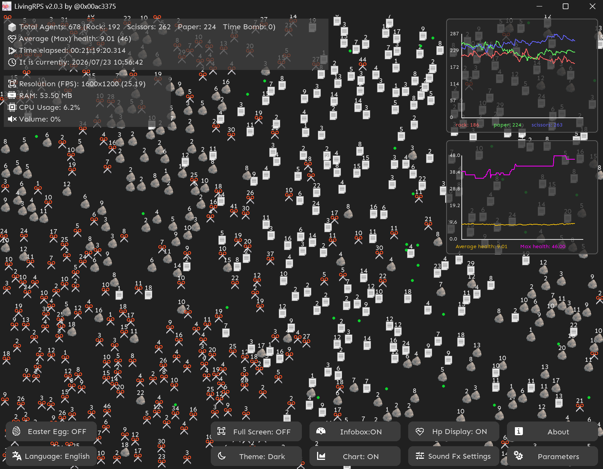
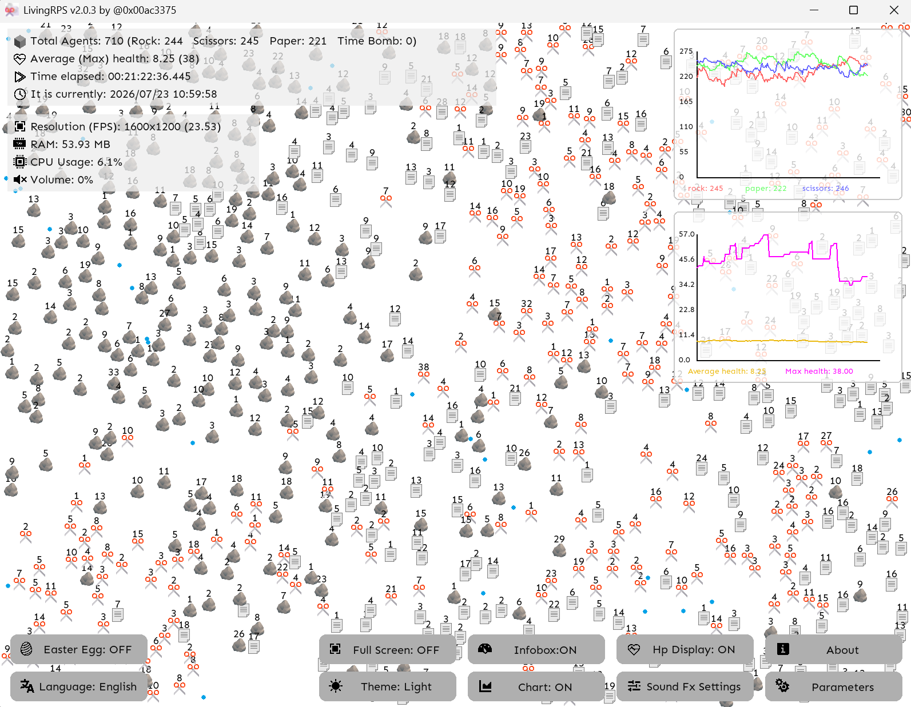

This is a rock-paper-scissors simulation program inspired by a TikTok Account @livingrps.

Idea is not mine, but the implementation is.

## Features

A dynamic Rock-Paper-Scissors ecology simulator for Windows 11.

- Real-time emergent behavior
- Elastic collisions + RPS combat
- Healing Packs & Splitting
- Dynamic overflow population pressure
- Sound-reactive drum-machine mode
- Parameter-control panel & line chart in-game.
- An *easter egg* about *Rational Number Modulo* (people who participate in algorithm contests may be familiar with this thing :) )





This application has been developed by 0x00ac3375.

Email: Jake3375@126.com  22281093@bjtu.edu.cn

**Disclaimer on Assets**: The source code is licensed under MIT, but some of the icons, images, fonts and sounds located in the directory may NOT covered by this license. They are used solely for the purpose of demonstrating this project. If you are the copyright holder and believe your rights have been violated, please contact me via the email address above for removal.

## How to build

This application is developed with Python and Pygame.

You can build by entering the command below.

```
pyinstaller `
--onefile --noconsole --icon=logo.ico `
--add-data "./logo.ico;." `
--add-data "./7seg.ttf;." --add-data "./seguiemj.ttf;." --add-data "./Sen-Regular.otf;." --add-data "./zh-cn.ttf;." `
--add-data "./clap.wav;." --add-data "./hi-hat.wav;." --add-data "./kick.wav;." --add-data "./snare.wav;." `
--add-data "./mining.ogg;." --add-data "./destruction_bomb.ogg;." --add-data "./destruction_mixer.ogg;." `
--add-data "./bomb.svg;." `
--add-data "./box.svg;." `
--add-data "./box_dark.svg;." --add-data "./box_light.svg;." `
--add-data "./clock_dark.svg;." --add-data "./clock_light.svg;." `
--add-data "./cymbal.wav;." `
--add-data "./heart.svg;." --add-data "./heart_dark.svg;." --add-data "./heart_light.svg;." `
--add-data "./laptop.svg;." `
--add-data "./memory.svg;." --add-data "./memory_dark.svg;." --add-data "./memory_light.svg;." `
--add-data "./paper.svg;." --add-data "./rock.svg;." --add-data "./scissors.svg;." `
--add-data "./resolution_dark.svg;." --add-data "./resolution_light.svg;." `
--add-data "./systemclock.svg;." --add-data "./timer.svg;." `
--add-data "./cpu_dark.svg;." --add-data "./cpu_light.svg;." `
--add-data "./warning_dark.svg;." --add-data "./warning_light.svg;." `
--add-data "./timer_dark.svg;." --add-data "./timer_light.svg;." `
--add-data "./volume_dark.svg;." --add-data "./volume_light.svg;." `
--add-data "./volume_mute_dark.svg;." --add-data "./volume_mute_light.svg;." `
--add-data "./volume_down_dark.svg;." --add-data "./volume_down_light.svg;." `
--add-data "./volume_big_dark.svg;." --add-data "./volume_big_light.svg;." `
--add-data "./fullscreen_dark.svg;." --add-data "./fullscreen_light.svg;." `
--add-data "./settings_dark.svg;." --add-data "./settings_light.svg;." `
--add-data "./information_dark.svg;." --add-data "./information_light.svg;." `
--add-data "./sound_dark.svg;." --add-data "./sound_light.svg;." `
--add-data "./warning.svg;." `
--add-data "./theme_light.svg;." --add-data "./theme_dark.svg;." `
--add-data "./language_light.svg;." --add-data "./language_dark.svg;." `
--add-data "./chart_light.svg;." --add-data "./chart_dark.svg;." `
--add-data "./easter_egg_light.svg;." --add-data "./easter_egg_dark.svg;." `
--add-data "./dashboard_light.svg;." --add-data "./dashboard_dark.svg;." `
--add-data "./slider_light.svg;." --add-data "./slider_dark.svg;." `
--add-data "./i18n.ja-jp.txt;." --add-data "./i18n.zh-cn.txt;." --add-data "./i18n.zh-tw.txt;." `
"./LivingRPS v2.0.3.py"
```